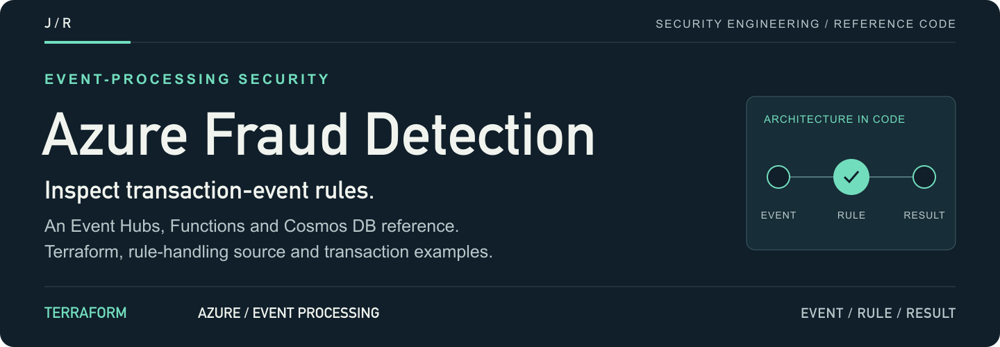
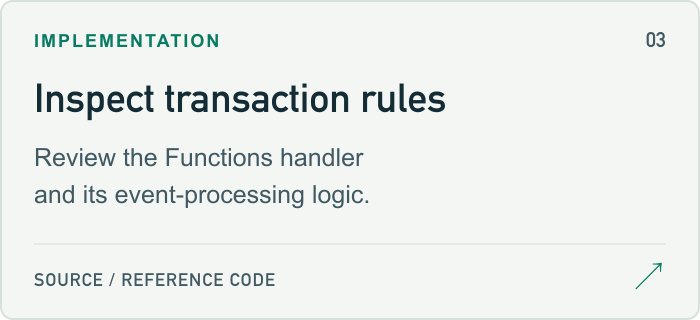
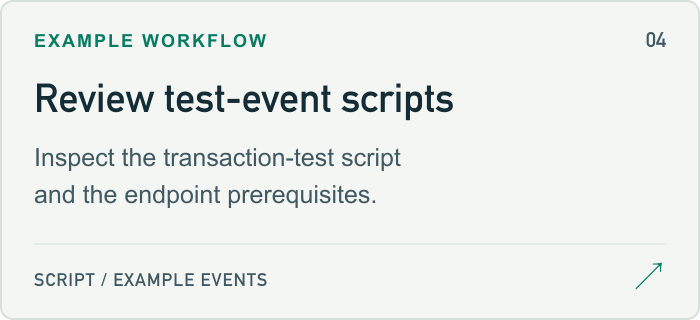

<a id="azure-real-time-fraud-detection-system"></a>

<a href="#setup-guide">
<picture>
  <source media="(max-width: 600px)" srcset="docs/assets/readme/header-mobile.png">
  
</picture>
</a>

<p>
  <a href="#setup-guide"><strong>Start here ↗</strong></a> &nbsp; / &nbsp;
  <a href="main.tf">Source</a> &nbsp; / &nbsp;
  <a href="#project-guide">Project guide</a> &nbsp; / &nbsp;
  <a href="https://github.com/jmragsdale">Profile</a>
</p>

An Azure event-processing reference for transaction-rule research, with Terraform, a Functions handler and test-event scripts.

## Explore the project

Open a card for source, examples or supporting documentation.

<p>
<a href="az-fraud-detection.svg">
<picture>
  <source media="(prefers-color-scheme: dark)" srcset="docs/assets/readme/architecture-dark.png">
  
</picture>
</a>
<a href="main.tf">
<picture>
  <source media="(prefers-color-scheme: dark)" srcset="docs/assets/readme/source-dark.png">
  
</picture>
</a>
<a href="function-app/FraudDetector/index.js">
<picture>
  <source media="(prefers-color-scheme: dark)" srcset="docs/assets/readme/handler-dark.png">
  
</picture>
</a>
<a href="scripts/test-transaction.sh">
<picture>
  <source media="(prefers-color-scheme: dark)" srcset="docs/assets/readme/events-dark.png">
  
</picture>
</a>
</p>

## Project guide

Real-time fraud detection for financial transactions using Azure Event Hubs, Functions, and Cosmos DB with Terraform IaC.

## Architecture

- **Event Hubs**: Transaction stream ingestion
- **Azure Functions**: Real-time fraud detection logic
- **Cosmos DB**: Transaction storage and history
- **Key Vault**: Secure credential management
- **Managed Identity**: Zero-trust authentication
- **Application Insights**: Monitoring and alerting

## Features

✅ Real-time event processing (1000+ TPS)  
✅ Multi-factor fraud detection rules  
✅ Zero-trust security with Managed Identity  
✅ Infrastructure as Code with Terraform  
✅ PCI-DSS and SOC 2 compliance patterns  

<a id="setup-guide"></a>

## Quick Start

```bash
# Configure Azure CLI
az login

# Deploy infrastructure
./scripts/deploy.sh

# Test the system
./scripts/test-transaction.sh

# View logs
az functionapp log tail \
  -n $(terraform output -raw function_app_name) \
  -g $(terraform output -raw resource_group_name)
```

## Configuration

Edit `terraform.tfvars`:
- `alert_email`: Your email for fraud alerts
- `fraud_threshold`: Dollar amount trigger (default: $1000)
- `velocity_threshold`: Transaction count trigger (default: 5)

## Fraud Detection Rules

- High amount transactions (>$1000)
- International locations
- Round number amounts
- Late night activity (00:00-05:00)
- High velocity (>5 transactions)

## Cost Estimate

~$20-30/month for development usage

## Cleanup

```bash
terraform destroy
```

## Talking Points

- Real-time fraud detection processing 1000+ TPS
- Zero-trust security with Azure Managed Identity
- Event-driven architecture for fintech compliance
- Infrastructure as Code with Terraform

<details>
<summary>README visual assets</summary>

[Artwork sources and regeneration notes](docs/assets/readme/README.md).

</details>
